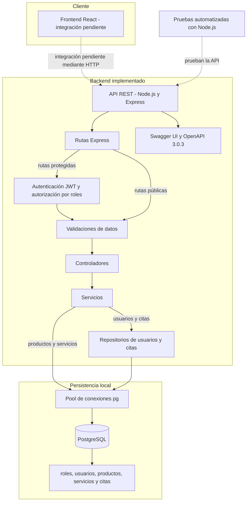
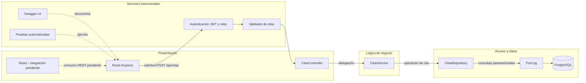

# Arquitectura del proyecto Happy Paws

**Asignatura:** DSY1104<br>
**Guía:** 19<br>
**Tipo de documento:** descripción de arquitectura de software

## 1. Propósito y alcance

Este documento describe la arquitectura del backend Happy Paws y su relación con el frontend React disponible en el repositorio externo [evaluacion_2_definitiva](https://github.com/ervin-millanguir/evaluacion_2_definitiva). El frontend existe, pero su integración efectiva con esta API sigue pendiente.

Los diagramas distinguen la integración pendiente del frontend respecto de los componentes existentes en este repositorio. La arquitectura AWS y la conexión definitiva con Amazon RDS también se mantienen como trabajo pendiente, según el estado documentado del proyecto.

## 2. Vista general de la arquitectura

<!-- mermaid-checked: no \n, no em-dash/en-dash, no {} in labels, subgraphs are id["label"], arrows are -->|"label"|, all subgraphs closed by end, ids unique -->


El backend se inicia desde `backend/nodejs/server.js`. La aplicación Express registra las rutas, middlewares generales, documentación Swagger y configuración de acceso a PostgreSQL. La comunicación con la base de datos se implementa mediante `pg` y consultas parametrizadas.

### 2.1. Componentes y responsabilidades

| Componente | Tecnología o ubicación | Responsabilidad |
|---|---|---|
| Cliente web | React en el repositorio externo [evaluacion_2_definitiva](https://github.com/ervin-millanguir/evaluacion_2_definitiva) | Interfaz existente cuya integración efectiva con esta API REST está pendiente. |
| Aplicación HTTP | Node.js y Express | Recibe solicitudes, registra middlewares y monta rutas de API y documentación. |
| Rutas | `backend/nodejs/src/routes/` | Asocia métodos y rutas HTTP con controladores y aplica autenticación, roles y validaciones cuando corresponde. |
| Autenticación | `src/middleware/auth.middleware.js` | Verifica JWT HS256 y obtiene el rol vigente del usuario activo; `src/middlewares/auth.middleware.js` reexporta este middleware para compatibilidad. |
| Autorización | `autorizarRoles` en `auth.middleware.js` | Limita acciones según el rol del usuario autenticado, por ejemplo `CLIENTE` o `ADMIN`. |
| Validadores | `backend/nodejs/src/validators/` | Comprueban los datos de registro, inicio de sesión y citas; informan errores de entrada con HTTP 400. |
| Controladores | `backend/nodejs/src/controllers/` | Atienden solicitudes y respuestas HTTP, delegando el trabajo de negocio a los servicios. |
| Servicios | `backend/nodejs/src/services/` | Implementan las operaciones de negocio de autenticación, citas, productos y servicios. |
| Repositorios | `backend/nodejs/src/repositories/` | Encapsulan consultas de usuarios y citas. Los servicios de productos y servicios consultan `pg` directamente; no existe un repositorio separado para esos módulos. |
| Persistencia | PostgreSQL y `backend/nodejs/src/config/database.js` | Almacena las cinco tablas del sistema y recibe consultas mediante un pool de conexiones. |
| Documentación de API | Swagger UI y OpenAPI | Publica la interfaz en `/api-docs` y `/api/docs`, y la especificación JSON en `/api-docs.json` y `/api/docs.json`. |
| Pruebas automatizadas | Node.js Test Runner y `backend/nodejs/tests/api.test.js` | Comprueba respuestas de API, autenticación, permisos y operaciones de negocio usando una base de pruebas configurada separadamente. |

### 2.2. Tablas de PostgreSQL

Las definiciones están distribuidas entre los scripts SQL de `backend/nodejs/database/`: `auth.sql`, `usuarios_roles.sql`, `schema.sql` y `citas.sql`. En conjunto, describen estas cinco tablas:

| Tabla | Responsabilidad | Relaciones relevantes |
|---|---|---|
| `roles` | Catálogo de roles, incluidos `CLIENTE` y `ADMIN`. | Referenciada por `usuarios`. |
| `usuarios` | Datos de cuenta, contacto, estado y hash de contraseña. | Tiene una referencia a `roles`. |
| `productos` | Catálogo de productos con nombre, precio y stock. | No se declara una relación con las otras tablas en el esquema revisado. |
| `servicios` | Catálogo de servicios veterinarios y sus precios. | Referenciada por `citas`. |
| `citas` | Solicitudes de atención veterinaria, mascota, fecha, hora, motivo y estado. | Referencia a `usuarios` y `servicios`; un índice único parcial impide duplicar un horario activo para un servicio. |

### 2.3. Rutas públicas y protegidas

La clasificación siguiente corresponde a las rutas registradas en los archivos revisados. Una ruta protegida requiere un JWT válido; además, las operaciones administrativas o de cliente aplican autorización por rol.

| Acceso | Rutas | Restricción o uso |
|---|---|---|
| Público | `GET /api/saludo` | Comprobación de la API. |
| Público | `GET /api/productos` y `GET /api/productos/:id` | Consulta del catálogo de productos. |
| Público | `GET /api/servicios` y `GET /api/servicios/:id` | Consulta del catálogo de servicios. |
| Público | `POST /api/auth/register`, `POST /api/auth/registro` y `POST /api/auth/login` | Registro e inicio de sesión. Las rutas de registro asignan respectivamente `CLIENTE` y `dueno_mascota`; ambos roles se autorizan como cliente. |
| Protegido | `GET /api/auth/me` | Requiere autenticación JWT. |
| Protegido, propietario o `ADMIN` | `GET /api/usuarios/:id` y `PUT /api/usuarios/:id` | Consulta o modifica datos de usuario; solo `ADMIN` puede cambiar rol o estado. |
| Protegido, `ADMIN` | `GET /api/usuarios`, `POST /api/usuarios`, `DELETE /api/usuarios/:id` y `PATCH /api/usuarios/:id/desactivar` | Administra usuarios; las bajas son lógicas. |
| Protegido, `ADMIN` | `POST /api/productos`, `PUT /api/productos/:id` y `DELETE /api/productos/:id` | Administración de productos. |
| Protegido, `ADMIN` | `POST /api/servicios`, `PUT /api/servicios/:id` y `DELETE /api/servicios/:id` | Administración de servicios. |
| Protegido, `CLIENTE` | `POST /api/citas` | Registra una cita para el usuario autenticado. |
| Protegido, `CLIENTE` | `GET /api/citas/mis-citas` | Lista las citas del usuario autenticado. |
| Protegido, `ADMIN` | `GET /api/citas` | Lista todas las citas. |
| Protegido, `CLIENTE` o `ADMIN` | `GET /api/citas/:id` | El servicio también comprueba que un cliente solo consulte sus propias citas. |
| Protegido, `ADMIN` | `PATCH /api/citas/:id/estado` | Cambia el estado de una cita. |

La interfaz Swagger se sirve en `/api-docs` y `/api/docs`; el documento JSON está en `/api-docs.json` y `/api/docs.json`. Helmet protege las respuestas, el rate limit restringe los intentos de inicio de sesión y CORS admite solo los orígenes configurados.

## 3. Componentes y relaciones

<!-- mermaid-checked: no \n, no em-dash/en-dash, no {} in labels, subgraphs are id["label"], arrows are -->|"label"|, all subgraphs closed by end, ids unique -->


En el flujo de citas, autenticación y autorización se ejecutan según el orden de middlewares definido por la ruta. El cliente React se representa únicamente como consumidor futuro: no hay evidencia de integración efectiva en el código inspeccionado.

## 4. Flujo de solicitud de una cita veterinaria

El siguiente flujo describe el comportamiento implementado para `POST /api/citas`; la comunicación desde React se marca como pendiente:

1. **Cliente React:** en la arquitectura objetivo, la interfaz enviaría una solicitud HTTP `POST /api/citas` con los datos de la mascota, el servicio, la fecha, la hora y el motivo. La solicitud incluiría `Authorization: Bearer <token>` obtenido previamente desde el inicio de sesión. La integración con React aún no está implementada.
2. **Express y enrutamiento:** Express recibe la solicitud JSON y la ruta de citas inicia la cadena de procesamiento.
3. **Autenticación JWT:** el middleware comprueba la presencia del token, verifica su firma y sus atributos configurados, y consulta al repositorio de usuarios para confirmar que la cuenta existe y está activa. Si no corresponde, responde con HTTP 401.
4. **Autorización por rol:** `autorizarRoles("CLIENTE")` permite que solo un cliente autenticado solicite la cita; un rol no autorizado recibe HTTP 403.
5. **Validación de datos:** el validador comprueba el identificador de servicio, nombre y especie de la mascota, fecha válida no anterior al día actual, formato de hora y motivo. Si hay errores, la API responde HTTP 400 con el detalle de validación.
6. **Controlador:** `citas.controller.js` obtiene el identificador del usuario desde el contexto autenticado y delega la operación al servicio de citas.
7. **Servicio:** `citas.service.js` solicita al repositorio la creación de la cita y transforma conflictos conocidos de PostgreSQL en respuestas de dominio. Una referencia inexistente produce HTTP 404; un horario activo duplicado produce HTTP 409.
8. **Repositorio y PostgreSQL:** `citas.repository.js` ejecuta un `INSERT` parametrizado en `citas`, usando los identificadores de usuario y servicio y los datos validados. Las restricciones de clave foránea y el índice único parcial protegen las relaciones y la disponibilidad del horario activo.
9. **Lectura del registro creado:** tras insertar, el repositorio consulta nuevamente la cita y la relaciona con `servicios` para incluir el nombre del servicio y los datos de respuesta.
10. **Respuesta:** el controlador devuelve HTTP 201 y el objeto de cita en JSON. En el diseño objetivo, React recibiría esa respuesta por HTTP y podría actualizar su interfaz; esa integración no se encuentra en el repositorio.

```text
React (pendiente) -> HTTP REST -> Express y rutas -> JWT y rol CLIENTE
-> validación -> controlador -> servicio -> repositorio -> PostgreSQL
-> cita creada -> JSON HTTP 201 -> React (integración pendiente)
```

## 5. Documentación y pruebas

La especificación OpenAPI combina las rutas anotadas con las rutas de compatibilidad EP3. `swagger-ui-express` publica la interfaz en `/api-docs` y `/api/docs`; Express entrega el JSON en `/api-docs.json` y `/api/docs.json`. La configuración define OpenAPI 3.0.3 y el esquema de seguridad Bearer JWT.

Las pruebas usan el ejecutor integrado de Node.js y se ubican en `backend/nodejs/tests/api.test.js`. El archivo actual contiene escenarios de API que incluyen autenticación, autorización, registros y operaciones de citas, junto con productos y servicios. El script `npm test` usa `.env.test`, separado de `.env`; antes de importar la aplicación, la suite exige `DB_HOST=localhost` o `127.0.0.1` y `DB_NAME=happy_paws_test`.

La evidencia de Guía 19 conserva el resultado previo de **22 pruebas aprobadas y 0 fallidas** en `evidencias/pruebas-automatizadas-guia19.txt`; `evidencias/pruebas-automatizadas.txt` conserva el histórico anterior de **10 aprobadas y 0 fallidas**. La validación funcional de integración del 25 de noviembre de 2026 ejecutó la suite ampliada con **29 aprobadas y 0 fallidas**. La suite usa `.env.test` y exige que `DB_HOST` sea `localhost` o `127.0.0.1` y `DB_NAME` sea `happy_paws_test` antes de abrir una conexión.

## 6. Estado de implementación

| Estado | Elementos |
|---|---|
| Implementado en el backend del repositorio | API Node.js/Express; rutas de autenticación, usuarios, productos, servicios y citas; middleware JWT y roles; validadores; controladores y servicios; repositorios de usuarios y citas; consultas parametrizadas; configuración de conexión PostgreSQL; scripts para las cinco tablas; documentación Swagger; suite automatizada ampliada. |
| Evidencia local disponible | Suite integrada ejecutada el 25-11-2026: 29 aprobadas y 0 fallidas. Los resultados históricos de Guía 19 (22/0) y del registro anterior (10/0) se conservan. Ninguno demuestra por sí mismo un despliegue remoto. |
| Pendiente | Integrar efectivamente el frontend React existente en [evaluacion_2_definitiva](https://github.com/ervin-millanguir/evaluacion_2_definitiva) con esta API; desplegar y verificar la arquitectura completa en AWS, incluida la integración efectiva con Amazon RDS. |

La documentación anterior del proyecto menciona una implementación inicial de Express en EC2. Sin embargo, también identifica como pendientes la conectividad y la integración definitiva con RDS. Por ello, esta guía no considera el despliegue completo en AWS como verificado. La Guía 18 existente en `docs/arquitectura.md` se conserva sin modificaciones.

## 7. Referencias del repositorio

- [Aplicación Express](../backend/nodejs/src/app.js)
- [Rutas de citas](../backend/nodejs/src/routes/citas.routes.js)
- [Middleware de autenticación y roles](../backend/nodejs/src/middleware/auth.middleware.js)
- [Validaciones de citas](../backend/nodejs/src/validators/citas.validator.js)
- [Controlador de citas](../backend/nodejs/src/controllers/citas.controller.js)
- [Servicio de citas](../backend/nodejs/src/services/citas.service.js)
- [Repositorio de citas](../backend/nodejs/src/repositories/citas.repository.js)
- [Configuración PostgreSQL](../backend/nodejs/src/config/database.js)
- [Especificación Swagger](../backend/nodejs/src/docs/swagger.js)
- [Esquema de productos y servicios](../backend/nodejs/database/schema.sql)
- [Esquema de roles y usuarios](../backend/nodejs/database/auth.sql)
- [Migración de compatibilidad de usuarios y roles](../backend/nodejs/database/usuarios_roles.sql)
- [Esquema de citas](../backend/nodejs/database/citas.sql)
- [Pruebas automatizadas de API](../backend/nodejs/tests/api.test.js)
- [Evidencia reportada de Guía 19](../evidencias/pruebas-automatizadas-guia19.txt)
- [Evidencia archivada de pruebas](../evidencias/pruebas-automatizadas.txt)
