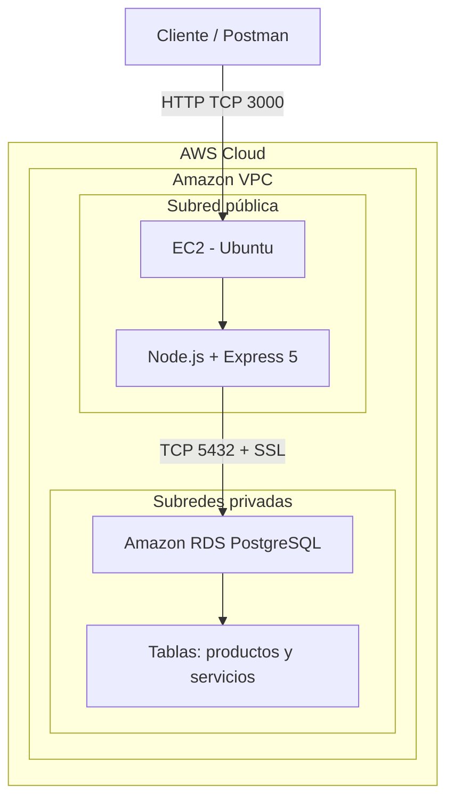
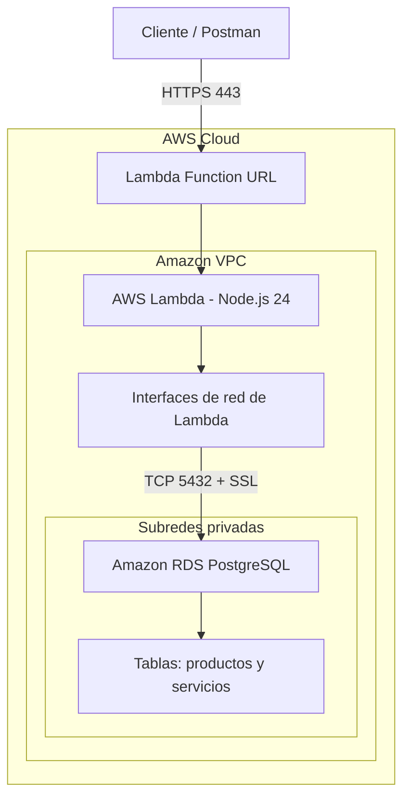

# Arquitectura Happy Paws — Guía 18

## 1. Arquitectura Express en EC2

Express recibe las solicitudes HTTP, valida los datos
y ejecuta consultas parametrizadas sobre PostgreSQL.

El grupo de seguridad de RDS permite conexiones
desde el grupo de seguridad de EC2 por el puerto 5432.

## 2. Arquitectura AWS Lambda

Lambda procesa las solicitudes mediante su handler
y utiliza la biblioteca pg para conectarse a PostgreSQL.

El grupo de seguridad de RDS permite conexiones
desde el grupo de seguridad asignado a Lambda.

## 3. Reglas de seguridad propuestas

| Origen | Destino | Puerto |
|---|---|---|
| IP autorizada | EC2 - SSH | 22 |
| IP autorizada | EC2 - Express | 3000 |
| Cliente | Function URL | 443 |
| SG de EC2 | SG de RDS | 5432 |
| SG de Lambda | SG de RDS | 5432 |

Amazon RDS no tendrá acceso público.

## 4. Estado de implementación

La arquitectura representa el diseño final propuesto.

La comunicación entre Express, Lambda y PostgreSQL
fue validada localmente el 24 de noviembre de 2026.

La implementación definitiva en AWS se encuentra
pendiente debido a la incidencia INC-001,
registrada en el README del proyecto.