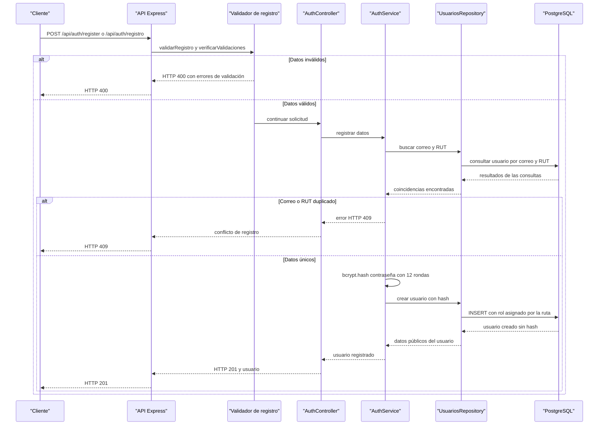
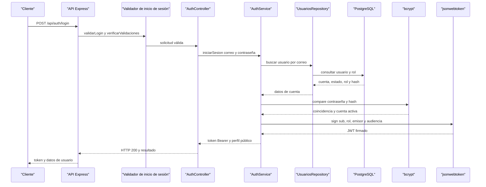
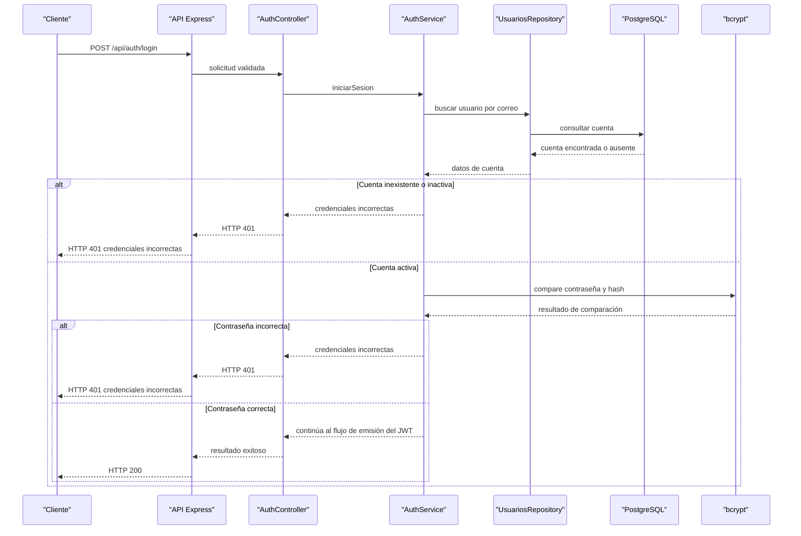
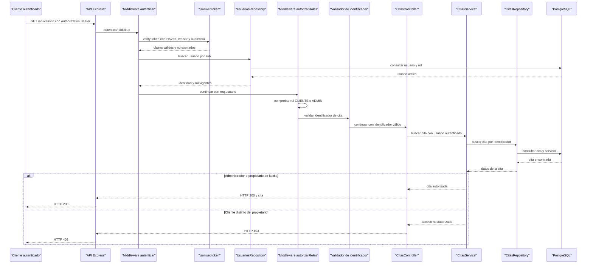
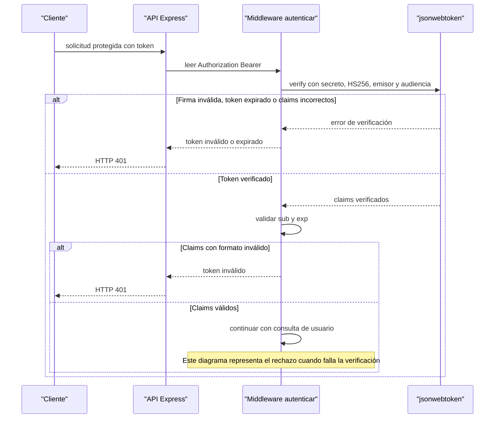
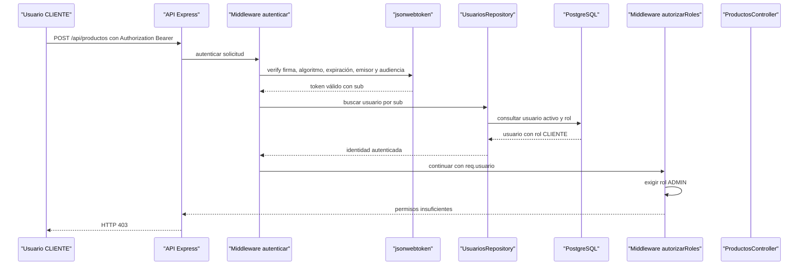

# Secuencias de autenticación y autorización - Happy Paws

**Asignatura:** DSY1104 
**Guía:** 19 
**Alcance:** flujos de autenticación y autorización implementados en el backend Node.js con Express.

## 1. Registro de usuario

Los endpoints públicos `POST /api/auth/register` y `POST /api/auth/registro` comparten validaciones, verifican correo y RUT duplicados y generan el hash con bcrypt usando 12 rondas. El primero asigna `CLIENTE`; el alias EP3 `/registro` asigna `dueno_mascota`. Ambos roles se normalizan como cliente al autorizar. La respuesta no incluye el hash.

<!-- mermaid-checked: every participant uses `participant Id as "Label"`, no \n in aliases/messages/notes, every alt/opt/loop closed by end, no `:` inside any alias -->

La asignación del rol se fija en `auth.routes.js` y la inserción obtiene el identificador del catálogo `roles`. Las restricciones únicas de la base de datos también permiten detectar una colisión de correo o RUT ocurrida entre la comprobación y la inserción; el servicio la transforma en HTTP 409.

## 2. Inicio de sesión exitoso y emisión del JWT

El endpoint público `POST /api/auth/login` valida el formato de la solicitud. El servicio busca la cuenta por correo, comprueba que esté activa y compara la contraseña recibida con su hash. Solo si la autenticación resulta exitosa, firma un JWT y devuelve el token como Bearer junto con datos públicos del usuario.

<!-- mermaid-checked: every participant uses `participant Id as "Label"`, no \n in aliases/messages/notes, every alt/opt/loop closed by end, no `:` inside any alias -->

El token se firma con algoritmo **HS256**. Su duración predeterminada es **una hora** (`1h`), configurable mediante `JWT_EXPIRES_IN`. El contenido incluye `sub`, `id` para compatibilidad con el cliente EP3, el rol, el emisor y la audiencia. La firma usa el secreto configurado en `JWT_SECRET`, que nunca se incorpora como claim al token.

## 3. Inicio de sesión con credenciales incorrectas

Una cuenta inexistente, inactiva o una contraseña que no coincide produce el mismo resultado externo: HTTP 401 y el mensaje genérico de credenciales incorrectas. Para cuentas inexistentes o inactivas, la comparación bcrypt no se ejecuta; si la cuenta está activa, bcrypt compara la contraseña con el hash almacenado.

<!-- mermaid-checked: every participant uses `participant Id as "Label"`, no \n in aliases/messages/notes, every alt/opt/loop closed by end, no `:` inside any alias -->

El inicio de sesión también está limitado por un middleware de tasa: el backend permite hasta 10 intentos en una ventana de 15 minutos y responde HTTP 429 cuando se supera el límite.

## 4. Acceso autorizado a una ruta protegida

El ejemplo representa `GET /api/citas/:id`, que permite los roles `CLIENTE`/`dueno_mascota` y `ADMIN`/`administrador`. Tras verificar el token, el middleware busca al usuario en la base de datos y exige que esté activo; el rol se obtiene del registro actual y no se confía en el claim de rol del JWT. El servicio de citas comprueba la propiedad: un administrador puede consultar cualquier cita y un cliente solo puede consultar una cita propia.

<!-- mermaid-checked: every participant uses `participant Id as "Label"`, no \n in aliases/messages/notes, every alt/opt/loop closed by end, no `:` inside any alias -->

La verificación JWT precede a la autorización por rol. En las rutas de citas se aplican dos controles diferentes: el middleware limita los roles admitidos por cada operación y, para consultar una cita individual, el servicio comprueba además la propiedad del registro.

## 5. Rechazo de un token inválido o expirado

Para aceptar una solicitud protegida, `jsonwebtoken.verify` valida la firma con `JWT_SECRET`, restringe el algoritmo a HS256 y comprueba expiración, emisor y audiencia. El middleware requiere además un `exp` entero futuro y un identificador válido en `sub` o, para compatibilidad, en `id`. Los errores se responden con HTTP 401 antes de consultar al usuario o ejecutar el controlador.

<!-- mermaid-checked: every participant uses `participant Id as "Label"`, no \n in aliases/messages/notes, every alt/opt/loop closed by end, no `:` inside any alias -->

Un encabezado ausente o que no use el formato Bearer también se rechaza con HTTP 401. Si la verificación criptográfica resulta correcta pero la cuenta no existe o está inactiva, el middleware igualmente responde HTTP 401.

## 6. Rechazo por falta de permisos de rol

Este caso considera un token auténtico y una cuenta activa, pero con un rol que no está autorizado para la operación. Por ejemplo, un usuario `CLIENTE` que intenta crear un producto. El middleware de autenticación acepta la identidad; `autorizarRoles("ADMIN")` rechaza la operación con HTTP 403 y no invoca el controlador.

<!-- mermaid-checked: every participant uses `participant Id as "Label"`, no \n in aliases/messages/notes, every alt/opt/loop closed by end, no `:` inside any alias -->

## 7. Parámetros y políticas de seguridad

### 7.1. Parámetros JWT implementados

| Aspecto | Comportamiento |
|---|---|
| Algoritmo | HS256 al firmar; el middleware permite explícitamente únicamente HS256 al verificar. |
| Duración | Una hora por defecto (`1h`), con opción de configurar `JWT_EXPIRES_IN`. |
| Firma | `JWT_SECRET` se utiliza como secreto al firmar y verificar el token. |
| Emisor y audiencia | `JWT_ISSUER` y `JWT_AUDIENCE` se incluyen y se validan; si faltan, se usan los valores predeterminados `happy-paws-api` y `happy-paws-client`. |
| Expiración y claims | `jsonwebtoken.verify` rechaza tokens expirados; el middleware exige un `exp` entero futuro y un identificador válido en `sub` o `id`. |
| Identidad vigente | El middleware consulta el usuario en PostgreSQL y rechaza cuentas inexistentes o inactivas; obtiene el rol actual desde esa consulta. |
| Autorización | Los alias `ADMIN`/`administrador` y `CLIENTE`/`dueno_mascota` se normalizan; las rutas aplican roles y el servicio de citas verifica propiedad. |

### 7.2. Protección de secretos y transporte

El backend lee el secreto y los parámetros del token desde variables de entorno; el código no requiere incluir sus valores en la documentación. No se deben publicar credenciales ni subir archivos `.env`. En el entorno definitivo, los secretos deben provisionarse mediante configuración segura del entorno o un gestor de secretos, con valores distintos por entorno.

El uso de **HTTPS es requisito para el despliegue definitivo** y para transmitir credenciales de inicio de sesión y tokens fuera del entorno local. La configuración de desarrollo local puede usar HTTP; esto no debe interpretarse como una configuración adecuada para producción.

### 7.3. Cierre de sesión y renovación: propuesta pendiente

El backend revisado no implementa endpoint de cierre de sesión, revocación de JWT ni endpoint de renovación. Un JWT firmado sin estado de sesión en servidor sigue siendo válido hasta su expiración, aunque el cliente cierre su sesión.

Como política propuesta, el cliente debe descartar su token al cerrar sesión y debe solicitar un nuevo inicio de sesión al expirar. Si se requiere revocación inmediata o renovación sin volver a iniciar sesión, se deberá diseñar e implementar un mecanismo separado de tokens de renovación con rotación, expiración y revocación segura. Esta política es una recomendación pendiente, no una funcionalidad existente.

## 8. Estado de implementación

| Estado | Elementos |
|---|---|
| Implementado | Registro con validación, hash bcrypt de 12 rondas y roles fijados por ruta (`CLIENTE` o `dueno_mascota`); autenticación con bcrypt; JWT HS256 con expiración predeterminada de una hora, verificación de firma, expiración, emisor y audiencia; autenticación de cuentas activas; alias de roles; verificación de propiedad de citas individuales. |
| Propuesto o pendiente | Integración efectiva del frontend React con la API; política técnica de cierre de sesión y revocación; endpoint y mecanismo de renovación; configuración de HTTPS en el despliegue definitivo. |

## 9. Referencias del repositorio

- [Rutas de autenticación](../backend/nodejs/src/routes/auth.routes.js)
- [Servicio de autenticación](../backend/nodejs/src/services/auth.service.js)
- [Controlador de autenticación](../backend/nodejs/src/controllers/auth.controller.js)
- [Middleware JWT y autorización por roles](../backend/nodejs/src/middleware/auth.middleware.js)
- [Validadores de autenticación](../backend/nodejs/src/validators/auth.validator.js)
- [Repositorio de usuarios](../backend/nodejs/src/repositories/usuarios.repository.js)
- [Rutas de citas](../backend/nodejs/src/routes/citas.routes.js)
- [Servicio de citas y validación de propiedad](../backend/nodejs/src/services/citas.service.js)
- [Definición de roles y usuarios](../backend/nodejs/database/auth.sql)
- [Frontend React Happy Paws](https://github.com/ervin-millanguir/evaluacion_2_definitiva)
